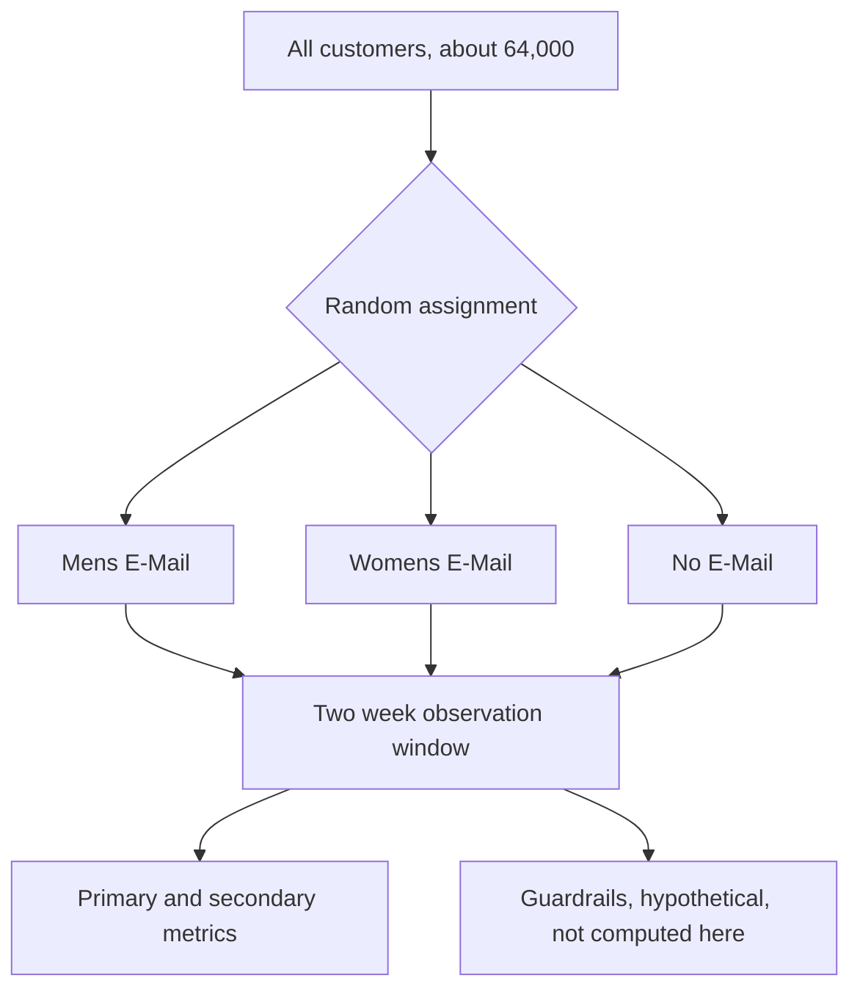
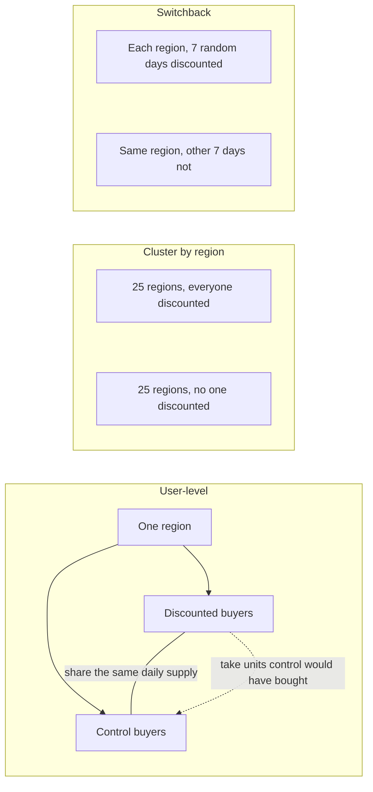

# Experiment design

## Overview

This project has two parts. Part 1 analyzes a public randomized experiment, the Hillstrom email test (MineThatData, 2008), and ends in a ship or target decision. Part 2 is a synthetic marketplace simulation on how interference biases user-level randomization.

This doc is the current design for both parts. Every choice is tagged with when it was locked, and git history holds every prior version.

| Tag | Meaning |
|---|---|
| [Pre-registered] | Part 1, committed before any outcome was compared across arms. Part 2, committed before the simulation was run |
| [Set after conversion] | Set after the conversion readout, before spend was split by arm |
| [Set after spend] | Set after the spend readout |

# Part 1. Hillstrom email experiment

## Setup

Customers who purchased in the last 12 months were randomly split roughly one third each into three arms. Outcomes were tracked for the two weeks after the send. The customer is both the unit of randomization and the unit of analysis.

| Item | Value |
|---|---|
| Rows | 64,000 customers |
| Arms | Mens E-Mail 21,307, Womens E-Mail 21,387, No E-Mail 21,306 |
| Pre-period columns | recency, history_segment, history, mens, womens, zip_code, newbie, channel |
| Outcome columns | visit, conversion, spend |

## Design at a glance

| Choice | Value | Locked |
|---|---|---|
| Primary metric | Conversion rate in the two week window | Pre-registered |
| Secondary metric | Mean spend per customer | Pre-registered |
| Guardrails | Unsubscribe rate and next-send visit rate, hypothetical, not computed | Pre-registered |
| MDE | 0.5 percentage points absolute, a judgment call | Pre-registered |
| Alpha and power | 0.05 two-sided, 0.90 | Pre-registered |
| Planning alpha | 0.05 / 3 | Pre-registered |
| Required sample | 12,313 per arm, smallest actual arm 21,306 | Pre-registered |
| Primary comparisons | Mens vs No E-Mail, Womens vs No E-Mail, Mens vs Womens, Holm | Pre-registered |
| Segments | 11 levels, 22 tests on conversion, Benjamini-Hochberg | Pre-registered |
| Segment intervals | Wald with Newcombe cross-check, FCR level matched to BH | Set after spend |
| SRM bar | p below 0.0005 | Pre-registered |
| Balance bar | Absolute SMD of 0.1 or more is flagged | Pre-registered |
| Conversion interval | Wald, unpooled SE, 98.33%, Newcombe cross-check | Pre-registered |
| Spend test | Welch t plus BCa bootstrap, own Holm family | Pre-registered (Welch), Set after conversion (BCa, Holm) |
| Bootstrap resamples | 50,000 reported, 5,000 shown beside | Pre-registered (5,000), Set after spend (50,000) |
| Spend interval level | Matched to Holm rank, 98.33% / 97.5% / 95% | Set after spend |
| CUPED | history only, on conversion and spend, reported beside the unadjusted readout | Pre-registered (history), Set after spend (use) |
| Decision rule | Four tiers, Mens vs Womens tiebreaker, spend bar | Pre-registered, Set after conversion |

## Hypotheses

Conversion. H0 is that an email campaign has no effect on conversion rate compared to No E-Mail, and any difference seen is chance. H1 is that it changes conversion rate. The same pair applies to Mens vs Womens, comparing the two campaigns. [Pre-registered]

Spend. H0 is that an email campaign has no effect on mean spend per customer compared to No E-Mail. H1 is that it changes mean spend. The same pair applies to Mens vs Womens. [Pre-registered]

## Metrics

**Primary. Conversion rate**, whether the customer purchased in the two week window. [Pre-registered]

Why. Conversion is the behavior that matters to the business and has a clean power calculation. A visit without a purchase is a weaker signal.

**Secondary. Spend**, dollars purchased in the two week window. Feeds the dollar impact in the decision memo. [Pre-registered]

Why. The decision needs a dollar figure, but spend is heavy tailed and too noisy to be the primary test.

**Guardrails, hypothetical.** Unsubscribe rate, with a non-inferiority margin of 0.2 percentage points absolute. Visit rate on the next send 30 days later, with a drop margin of 1.5 percentage points. [Pre-registered]

Why. The dataset has no unsubscribe or repeat-send data, so these are named as what a live deployment would track, stated plainly as not computed. They cover two different risks, damage to the customer relationship and email fatigue.

## MDE, alpha, power, and sample size

All numbers below come from `notebooks/00_power_and_design.ipynb`, with the baseline validated in `notebooks/00_eda_pre_registration.ipynb`. [Pre-registered]

- Baseline conversion rate 0.9031%
- MDE 0.5 percentage points absolute
- Alpha 0.05 two-sided, power 0.90
- Planning alpha 0.05 / 3, the strictest bar Holm applies, so the power claim still holds after correction
- Required sample 12,313 per arm
- Smallest actual arm 21,306, a 1.73x margin, giving 99.27% power at the MDE
- Sensitivity check, not the decision bar. At this alpha and power the actual sample can detect effects as small as 0.3693 percentage points (about 40.9% relative)

Why the MDE. The sample size was fixed before this analysis, and there is no cost data to derive a business breakeven, so 0.5 percentage points is an explicit judgment call for a lift worth acting on. The required sample is then computed and checked against the real one, the same order a live test would follow.

Why 90% power. The sample affords it at no cost, so there is no reason to accept the extra risk of missing a real effect that 80% would allow.

## Comparisons and correction

Three primary comparisons on conversion, Mens vs No E-Mail, Womens vs No E-Mail, and Mens vs Womens, corrected together with Holm. [Pre-registered]

Why. Each comparison drives a costly rollout decision, so the family needs control over the chance of any false positive. Holm gives that guarantee and is less conservative than Bonferroni.

The same three comparisons on spend form their own separate Holm family. [Set after conversion]

Why. This keeps spend at the same false-positive control as conversion without changing the conversion results already reported.

## Pre-registered segments

Segments [Pre-registered]
- newbie (0, 1)
- channel (Phone, Web, Multichannel)
- zip_code (Rural, Surburban, Urban, spelled as in the source data)
- recency in tertiles (3 or less, 4 to 8, 9 or more months)

Why tertiles. They gave much more balanced group sizes than a fixed cutoff, a 1.13x largest-to-smallest ratio versus 1.93x.

Family. Inside each of the 11 levels, two comparisons on conversion run, Mens vs No E-Mail and Womens vs No E-Mail. That is 22 tests, corrected together with Benjamini-Hochberg. Mens vs Womens is not tested inside segments. If both emails beat No E-Mail in the same segment, the choice of email falls back on the overall Mens vs Womens primary comparison, and the gap inside the segment is reported as context only. [Pre-registered]

Why. Segment results feed a targeting recommendation, not an irreversible rollout, so missing a real segment effect is the costlier mistake. Each of the 22 tests answers the one question the targeted tier asks, and adding Mens vs Womens would cost about 4 to 5 points of power per level.

Power at the MDE, from `notebooks/00_segment_family_power.ipynb` using arm-pooled conversion per level. Under BH the real bar falls between alpha and alpha / 22, so power is a range. [Pre-registered]

| Segment level | Customers per arm (smallest) | Power at 0.5pp |
|---|---|---|
| newbie 0 / 1 | 10,611 / 10,686 | 58 to 90% / 71 to 95% |
| Phone / Web | 9,240 / 9,354 | 63 to 92% / 54 to 89% |
| Surburban / Urban | 9,501 / 8,542 | 61 to 92% / 50 to 86% |
| recency 3 or less / 4 to 8 / 9 or more | 7,438 / 7,157 / 6,529 | 30 to 71% / 48 to 85% / 46 to 84% |
| Multichannel | 2,577 | 6 to 31% |
| Rural | 3,139 | 9 to 40% |

All 11 levels stay in. Most are underpowered at the MDE, Multichannel and Rural badly so, so a non-significant segment is read as inconclusive, not as evidence of no effect.

## Analysis plan

### 1. Sanity checks

SRM. Chi-square goodness of fit of the arm counts against an equal one third split. A p-value below 0.0005 counts as a mismatch and stops the readout until the cause is found. [Pre-registered]

Why. SRM is a health check on randomization and logging, so false alarms need to be rare. The 0.0005 bar follows Fabijan et al. (2019), "Diagnosing Sample Ratio Mismatch in Online Controlled Experiments," KDD.

Covariate balance. Standardized mean differences for recency, history, mens, womens, newbie, and each level of zip_code and channel as 0/1 indicators, for every pair of arms. An absolute SMD of 0.1 or more is flagged and treated as a candidate for adjustment. history_segment is left out as a binned copy of history. If history is heavily skewed, SMD on log history is also reported as a robustness view, not a gate. [Pre-registered]

Why. SMD measures gap size independent of sample size, while a significance test at about 21,000 per arm would flag gaps too small to matter. The 0.1 cutoff follows Austin (2009), Statistics in Medicine, and serves here as a descriptive check.

### 2. Conversion readout

For each of the three comparisons [Pre-registered]
- Difference in conversion rates with a Wald interval, unpooled SE sqrt(p1(1-p1)/n1 + p2(1-p2)/n2)
- Newcombe hybrid score interval beside it as a cross-check (Newcombe 1998, Statistics in Medicine)
- Main interval at 98.33% (alpha / 3), ordinary 95% shown as context
- z-test using the same unpooled SE, pooled SE shown once as a cross-check
- Holm adjusted p-values

Why. Wald is the simplest interval to show and defend, and a pooled pre-check found about 192 expected conversions per arm, enough for its normal approximation. Using one SE for the test and the interval means they cannot disagree, and a 98.33% interval that excludes zero guarantees a Holm p-value below 0.05.

### 3. Spend readout

For each of the three comparisons
- Welch t-test on mean spend per customer [Pre-registered]
- BCa bootstrap interval (Efron 1987, Journal of the American Statistical Association), with the percentile interval beside it [Set after conversion]
- 50,000 resamples for the reported intervals, with the original 5,000 resample intervals shown beside them. The 50,000 result is reported whatever it shows [Pre-registered (5,000), Set after spend (50,000)]
- Seed stability. The decision-relevant bounds are recomputed over 50 seeds at 5,000 resamples and 10 seeds at 50,000, reporting min, median, max, and the share of seeds where each bound excludes zero. This is a robustness view, not a gate. If any seed at 50,000 flips a bound across zero, the result is reported as not robust across seeds, and the locked result is not changed [Set after spend]
- Holm adjusted Welch p-values, own family of three [Set after conversion]
- Interval level matched to the bar Holm uses at each rank, 98.33%, 97.5%, and 95% for the smallest, middle, and largest p-value. The rule as first written, every interval at 98.33%, is reported beside it [Set after spend]

A spend comparison counts as a significant lift only when the Holm adjusted Welch p-value is below 0.05 and the BCa interval at its matched level excludes zero. If the two disagree, the result is inconclusive. There is no minimum dollar bar. [Set after conversion, matched level set after spend]

Why. BCa corrects for bias and skew, which matters for heavy-tailed spend, and a convergence check (`notebooks/02_primary_readout.ipynb`, section 6) put its width at 5,000 resamples within about 0.7% of the width at 20,000. Requiring both methods to agree means no result depends on which one was picked, and there is no cost or margin data to base a dollar bar on.

### 4. CUPED

Covariate is history (past 12 month spend), the pre-period variable with the strongest pooled correlation to conversion (0.0294) among the candidates checked in `notebooks/00_eda_pre_registration.ipynb`. Variance reduction and the equivalent sample size saved are reported. [Pre-registered]

CUPED is applied to both conversion and spend. The decision stays on the unadjusted readout, and the CUPED-adjusted lifts and intervals are reported beside it as an efficiency result. No other covariates are added. [Set after spend, before any CUPED result was computed]

Why. Past spend was measured before the send, so the email cannot have affected it. A pooled check (`notebooks/00_cuped_covariate_check.ipynb`) found that adding all other pre-period variables would raise the variance reduction for conversion from 0.085% to 0.178%, worth about 20 extra customers per arm, too small to justify the added complexity.

### 5. Segment effects

Computed only for the 22 pre-registered tests above, with BH applied. [Pre-registered]

Each test uses the same Wald interval and unpooled z-test as the primary readout, with a Newcombe interval beside it. Intervals are false coverage rate intervals at level 1 - R q / m (Benjamini and Yekutieli 2005, Journal of the American Statistical Association), where R is the number of BH-significant tests, q = 0.05, and m = 22. The plain 95% interval is shown as context, and if no test is significant, intervals are shown at 95% and labeled unadjusted. If Wald and Newcombe disagree on whether an interval excludes zero, the segment is flagged as sensitive to the interval method. [Set after spend, before any segment outcome was computed]

Why. FCR intervals are dual to BH, so an interval excludes zero exactly when BH calls the test significant. A pooled check (`notebooks/00_segment_family_power.ipynb`, Step 7) found Multichannel and Rural can expect only about 15 to 18 No E-Mail conversions, where Wald is least reliable, so Newcombe is shown beside it.

If the targeted rollout tier is not triggered, segment results are descriptive and do not change who receives an email. A segment with a BH-significant negative lift is flagged in the decision memo as a risk and a candidate for a follow-up test, not automatically excluded. [Set after spend, before any segment outcome was computed]

Why. A rule for excluding or retargeting segments written after the overall results were known would be shaped by them. Flagging harm keeps a negative result from going unreported without adding that kind of rule.

### 6. Decision memo

Combines all of the above into one ship or target recommendation with a dollar estimate, in `docs/decision_memo.md`. [Pre-registered]

The dollar estimate covers one send over the two week window. It is the spend lift per customer times the number of customers, with the interval bounds scaled the same way, stated as revenue, not profit. It is not annualized, and no margin or email cost is applied, since the dataset has no send frequency, margin, or cost data. [Set after spend]

Why. This reports only what the experiment measured. Short-window effects can differ from long-run ones (Kohavi, Tang, and Xu 2020, Trustworthy Online Controlled Experiments, chapter 23), so repeat-send upside is named in words, not counted.

## Decision rule

**Tiers for each email against No E-Mail** [Pre-registered]

1. Ship broadly. The lift is significant after Holm and the estimated lift is at least the MDE (0.5 percentage points).
2. Statistically but not practically significant. The lift is significant but below the MDE. Conversion alone does not support a broad rollout, and spend drives the call.
3. Targeted rollout. The overall comparison is not significant, but a pre-registered segment (BH corrected) shows a significant, practically meaningful lift. Ship to that segment only.
4. Do not ship. Neither the overall comparison nor any segment clears both the statistical and practical bars.

**Spend bar for tier 2.** A campaign in tier 2 counts as shippable only if it shows a significant positive spend lift over No E-Mail, as defined in the spend readout. Otherwise it does not ship broadly. [Set after conversion]

**Choosing between the two emails.** If both emails clear the ship broadly bars, Mens vs Womens decides. One email wins if it is significantly better on conversion after Holm and at least 0.5 percentage points better. Otherwise the two are tied and the spend readout decides. [Pre-registered]

The same tiebreaker applies when one email ships broadly and the other is shippable through the tier 2 spend bar. A conversion tie then goes to Mens vs Womens on spend. [Set after conversion]

If that spend comparison is also inconclusive, Mens ships, as the only email that cleared both bars on conversion. [Set after conversion]

**Guardrails** are reported as a caveat, not a gate, since neither is computed from this dataset. [Pre-registered]

Why. At this sample size a tiny, meaningless lift can still come back significant, so a broad rollout needs both the statistical and the practical bar. The tiebreaker reuses those same bars, so no new threshold was introduced.

# Part 2. Interference simulation

## Question

In a marketplace, buyers in the same region compete for the same limited supply. If a discount is tested by randomizing individual buyers, discounted buyers take units that control buyers would have bought, and the test compares treated buyers against a control group the treatment itself made worse off. Part 2 estimates in simulation how much that biases a user-level test, and whether cluster-by-region and switchback designs remove the bias and at what cost in power.

All data here is synthetic. Every input is either grounded in Part 1, derived from already locked numbers, or taken from a cited source, and every choice below was committed before the main simulation runs.

## Setup

In the user-level design treated and control buyers share supply, so interference leaks between them. In the cluster design each region's supply is used by only one group. In the switchback design each region-day's supply is used by only one group, and no carryover between days is modeled.

## Design at a glance

| Choice | Value | Locked |
|---|---|---|
| Regions | 50 | Pre-registered |
| Buyers per region | 38,426 | Pre-registered |
| Test length | 14 days, daily periods | Pre-registered |
| Base purchase rate | 0.5726% over two weeks, 0.04101% a day | Pre-registered |
| Demand lift from the discount | +0.6805 percentage points over two weeks | Pre-registered |
| Region spread in base rate | Two levels, 0% (all regions equal) and 23.41% of the base rate, regions redrawn every run | Pre-registered |
| Supply | Fixed daily units per region, random rationing when demand exceeds it | Pre-registered |
| Supply tightness | 7 levels per region, two ends plus 5 between no-discount and everyone-discounted demand | Pre-registered |
| True effect | Global treatment effect, everyone discounted minus no one discounted | Pre-registered |
| Designs | User-level, cluster by region, switchback | Pre-registered |
| Measures | Bias, power, coverage of 95% intervals, each with its Monte Carlo SE, plus mean SE | Pre-registered |
| Alpha | 0.05 two-sided | Pre-registered |
| Runs | 10,000 per scenario, 14 main scenarios, 48 in all with the checks | Pre-registered |
| Seed | 42, one seed per scenario from 42 and its scenario ID, independent streams per run | Pre-registered |

## The market

Each region has buyers and a fixed number of supply units each day. Every day, each buyer wants to buy with some probability, higher if they have the discount. If more buyers want to buy than there are units, the units go to a random subset of them. A buyer converts on a day if they wanted to buy and got a unit. The outcome is conversion per buyer per day. [Pre-registered]

Demand is nested. A buyer who would buy without the discount also buys with it, and the discount adds buyers from the rest. Each day's demand is drawn fresh, so buyers have no lasting individual tendency to buy. [Pre-registered]

Why. The model has only the parts needed for discounted and control buyers to compete for the same units. Nesting means the discount only adds buyers, so the two worlds in the true effect differ only by the discount. The same mechanism appears in the eBay case in Blake and Coey (2014, "Why Marketplace Experimentation Is Harder than It Seems," ACM EC), where test and control bidders competed in the same auctions and the user-level estimate was too large by a factor of around two.

## Inputs

All numbers below come from `notebooks/00_sim_design_check.ipynb`. The percentages are rounded for reading. The simulation uses the unrounded values saved in `results/tables/sim_sensitivity_inputs.csv`, passed to the engine as two-week fractions. [Pre-registered]

**Base rate.** The two-week purchase rate with no discount is 0.5726%, the Part 1 No E-Mail conversion rate. [Pre-registered]

**Lift.** The discount raises the two-week purchase rate by 0.6805 percentage points, the Part 1 Mens vs No E-Mail lift, to 1.2531%. This is the lift in wanting to buy. The true effect on conversion comes out of the simulation after rationing and shrinks as supply tightens. [Pre-registered]

Why. Both come from one real randomized comparison, so the setup reads as the Part 1 effect placed in a market with limited supply. Hillstrom is an email retailer and an email is not a price discount, so these are grounded sizes, not evidence about how marketplaces or discounts behave.

**Daily rates.** Daily rate = 1 - (1 - two-week rate)^(1/14), giving 0.04101% with no discount and 0.09003% with it. This assumes the chance of buying is the same every day of the window, which Hillstrom cannot confirm because it has no purchase dates. [Pre-registered]

**Region spread.** Each region's two-week base rate is drawn from a beta distribution with mean 0.5726% and SD 23.41% of the mean, then converted to daily. At the 0% level every region has the base rate. The lift is added to each region's own two-week rate. Region rates are drawn again in every run, so each run is a new set of 50 regions. [Pre-registered]

Why. The spread in No E-Mail conversion across Hillstrom zip_code groups, after removing sampling noise, is 23.41% of the base rate, but a homogeneity test cannot tell it from zero (p = 0.103). Across zip_code by channel groups the estimate is zero. The data cannot rule out either end, so both are run.

## Market size

**Regions.** 50. [Pre-registered]

Why. Cameron and Miller (2015, "A Practitioner's Guide to Cluster-Robust Inference," Journal of Human Resources) say "few" clusters "may range from less than 20 to less than 50 clusters in the balanced case." 50 sits at the upper edge of that range, so the region-level t-tests here are borderline adequate rather than comfortable. The coverage results check this.

**Buyers per region.** 38,426, the smallest number where every supply level below can be set as planned at a region with the average base rate, found by checking every number upward. The condition that sets it is the tight end. With fewer buyers the average region would have zero no-discount demand on more than 1 in 7,000,000 days, so a 1 unit tight end would not hold. That region then sees about 15.8 buyers a day wanting to buy with no discount and 34.6 with everyone discounted. [Pre-registered]

Why. Rationing only happens if several buyers want to buy in the same region on the same day. An 80% power target for the cluster design would have given only 132 buyers per region, about 0.05 buyers per region a day wanting to buy with no discount, so the mechanism, not power, sets the size.

## Supply tightness

Each region's daily supply is set from its own exact binomial demand. No-discount demand is D0 ~ Binomial(buyers per region, region's no-discount daily rate), and everyone-discounted demand D1 is the same with the discounted rate. The error rate is eps = 1 / (50 regions x 14 days x 10,000 runs), 1 in 7,000,000. [Pre-registered]

- Loose end, the smallest supply S with P(D1 > S) at most eps. Rationing is expected on fewer than one region-day across all runs of a loose-end scenario, so every design should show bias consistent with zero here
- Tight end, the largest supply S with P(D0 < S) at most eps, with a floor of 1 unit. Supply runs out almost every day whether or not anyone is discounted, so the true effect is close to zero. Under spread, regions below the average rate miss eps even at 1 unit, but no-discount demand is zero on only 0.0215% of days in a 1st percentile region (`results/tables/sim_end_check_engine.csv`)
- The band, 5 levels spaced evenly from expected no-discount demand to expected everyone-discounted demand, both ends included, where expected demand is buyers per region times the region's daily rate. Levels are rounded to whole units, halves to the nearest even number

Levels are numbered 0 (tight end) to 6 (loose end), with 1 to 5 the band. At a region with the average rate they are 1, 16, 20, 25, 30, 35, and 69 units. Under spread some regions can repeat a band level after rounding, most often in the higher base rate check below.

Why. The error rate is derived from the run plan so a whole loose-end scenario expects under one rationed region-day. Setting ends per region keeps the loose-end bound in every region, which an earlier option of one supply ratio for all regions did not under spread. The tight end only needs the true effect to be near zero, so the 1 unit floor is enough there. 5 of the 7 levels sit in the band, where bias changes.

## True effect

The true effect is the global treatment effect, conversion with everyone discounted minus conversion with no one discounted. In each run it is (total conversions with everyone discounted minus total conversions with no one discounted) / (50 x buyers per region x 14), in conversions per buyer-day, computed on the same regions and nested demand draws used by the three designs. [Pre-registered]

Why. It is the effect of discounting everyone, which is what a full launch would deliver in this model. Johari, Li, Liskovich, and Weintraub (2022, "Experimental Design in Two-Sided Platforms: An Analysis of Bias," Management Science) define it this way and show that customer-side randomization is biased in supply-constrained markets. A buyer's own direct effect would make the user-level design look unbiased and hide the problem.

## Designs and their tests

All three designs use the same 50 regions, buyers, and 14 days. [Pre-registered]

| Design | Assignment | Estimate | Test and 95% interval |
|---|---|---|---|
| User-level | Half the buyers in each region, rounded down, drawn at random | Discounted minus control conversions per buyer-day | Two-proportion z-test on buyer-days, unpooled SE as in Part 1, estimate +/- 1.96 SE |
| Cluster by region | 25 of the 50 regions drawn at random | Mean region conversion, discounted regions minus control regions | Welch t-test on region conversion, estimate +/- t(0.975, Welch df) SE |
| Switchback | In each region, 7 of the 14 days drawn at random, independently across regions | Mean over regions of (discounted-day conversion minus control-day conversion) | One-sample t-test on the 50 region differences, estimate +/- t(0.975, 49) SE |

Why. The cluster test treats each region, the randomized unit, as independent. The switchback test uses one difference per region, so regions are the independent units and differences between regions drop out. The user-level test treats buyer-days as independent, which is what a team unaware of interference would run. Buyers here have no lasting tendency to buy, so the engine can split each region-day's buyers at random, which gives the same results as a fixed split of buyers.

No carryover between days is modeled. Carryover, where a treatment keeps affecting outcomes after it ends, is a main complication in real switchback experiments (Bojinov, Simchi-Levi, and Zhao 2023, "Design and Analysis of Switchback Experiments," Management Science), so the switchback results here are a best case with respect to carryover. [Pre-registered]

## What gets measured

For each design at each of the 14 main scenarios (7 tightness levels x 2 spread levels) [Pre-registered]
- Bias, the average over runs of (estimate minus that run's true effect), in conversions per buyer-day. Its Monte Carlo SE is the SD of (estimate minus true effect) across runs divided by the square root of the number of runs
- Power, the share of runs where the test rejects zero at alpha 0.05 two-sided. Where the true effect is about zero this is a false rejection rate, not power
- Coverage, the share of runs where the 95% interval contains that run's true effect. Because each run is scored against its own true effect, a design with a correct SE should land at or a little above 95%
- Mean SE, the average SE the design reports

Why coverage. Near the tight end the true effect is about zero, so user-level rejections there are mostly false. Coverage checks each interval against that run's true effect, so it shows this directly.

Why mean SE. At this market size the cluster and switchback designs both have close to 100% power at almost every level (formula check, `notebooks/00_sim_design_check.ipynb` section 12, `results/tables/sim_expected_power.csv`). They differ only in the lower band under spread, where expected power at the lowest band level is 32% for cluster and 100% for switchback. Power comparisons are read there, and mean SE shows the difference in precision at the other levels.

At the tight end region outcomes are nearly constant. With no spread every region sells its 1 unit almost every day, so the cluster and switchback SEs are often exactly 0. When an SE is exactly 0, the test does not reject and the interval is the point estimate alone, counted as covering only if it equals that run's true effect. The number of such runs is reported. Cluster and switchback power and coverage at the tight end are reported but marked not interpretable. [Pre-registered]

Why. An SE of 0 gives an interval with no width, so the point estimate is the only interval that does not invent variance. Marking the tight end keeps a near-certain cover there from reading as good calibration.

**Runs.** 10,000 per scenario. [Pre-registered]

Why. Morris, White, and Crowther (2019, "Using simulation studies to evaluate statistical methods," Statistics in Medicine) size runs from the target Monte Carlo SE, runs = p(1 - p) / SE^2. 10,000 keeps the SE of any power or coverage figure at or below 0.5 percentage points, for any true rate. Each result is reported with its Monte Carlo SE.

**Scenarios and seeds.** One master seed, 42. Each scenario gets its own seed from 42 and its scenario ID, and spawns an independent random stream for each of its 10,000 runs. Runs never share random numbers, any scenario can be rerun alone with the same results, and the order scenarios run in does not matter. [Pre-registered]

| IDs | Case | Spread | Levels |
|---|---|---|---|
| 1 to 7 | Main | 0% | 0 to 6 |
| 8 to 14 | Main | 23.41% | 0 to 6 |
| 15 to 17 | Zero lift | 0% | 0, 1, 6 |
| 18 to 20 | Zero lift | 23.41% | 0, 1, 6 |
| 21 to 27 | Higher base rate | 0% | 0 to 6 |
| 28 to 34 | Higher base rate | 23.41% | 0 to 6 |
| 35 to 41 | Smaller lift | 0% | 0 to 6 |
| 42 to 48 | Smaller lift | 23.41% | 0 to 6 |

Why. A seed tied to the scenario ID, not to run order, makes every scenario reproducible on its own.

## Checks before the main runs

The checks gate the main runs. If any check fails, the main runs wait until the bug is found. The fix is logged as a dated deviation and every check is rerun with the same seeds. [Pre-registered]

- Zero lift (scenarios 15 to 20). With no discount effect there is no interference, so every design's test should reject about 5% of the time. With zero lift, supply is set from the no-discount rate alone and the 5 band levels collapse into one, run as level 1. A design passes if an exact two-sided binomial test of its rejection count out of 10,000 against 5% does not reject after Holm correction, so a rate that is too low also fails. At the tight end only the user-level design is checked. There, region outcomes are nearly constant, so the cluster and switchback tests are degenerate or rest on a handful of regions, and their rejection rates are reported as context
- Loose end (scenarios 7 and 14, the main loose-end runs). Bias for every design should be consistent with zero, tested as bias divided by its Monte Carlo SE with a two-sided z-test
- Sensitivity (scenarios 21 to 48). Two cases, each changing one Part 1 input and resized with the same market rule, run at their own 7 tightness levels and both spread levels. Higher base rate, the No E-Mail visit rate (10.62% over two weeks) with the same +0.6805 percentage point lift, 5,572 buyers per region. Smaller lift, the Womens vs No E-Mail lift (+0.3111 percentage points) with the same 0.5726% base rate, 38,426 buyers per region. The user-level bias should still grow as supply tightens and the other two designs should still show bias consistent with zero. These results are descriptive, read against their Monte Carlo SEs

Why. Zero lift and the loose end are cases where the right answer is known, so a failure points to a bug, not to interference. Both sensitivity inputs are real rates from the same experiment, so the check uses grounded values rather than picked ones. The visit rate is a different behavior from buying and only tests whether the pattern holds at a higher rate.

Each check family is corrected with Holm, the same method as the Part 1 primary family, so the chance of any false alarm in a family stays at or below 5%. The loose-end family has 6 tests (3 designs x 2 spread levels) and the zero-lift family has 14 (3 designs x 3 levels x 2 spread levels, minus cluster and switchback at the tight end at both spread levels). [Pre-registered]

Why. Running many checks at an uncorrected 5% bar would make at least one false alarm likely even with no bug.

## Expected results, written before running

These are descriptive expectations, read against their Monte Carlo SEs, not formal tests. [Pre-registered]
- User-level bias is about zero at the loose end and grows as supply tightens, and its coverage falls well below 95% near the tight end
- Cluster and switchback bias stays about zero at every tightness level
- Cluster and switchback power are both near 100% at most levels. Switchback has more power than cluster in the lower band when regions differ, because each region is its own control. With no spread the two are about equal
