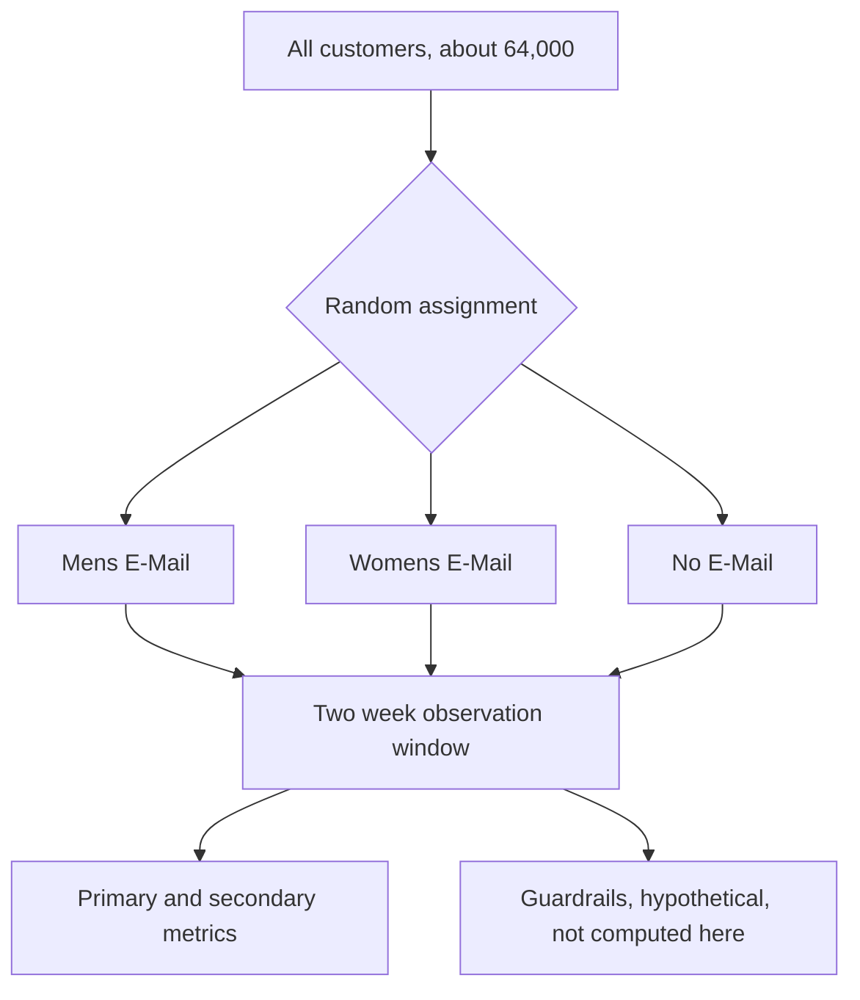

# Experiment design

## Overview

This project has two parts. Part 1 analyzes a public randomized experiment, the Hillstrom email test (MineThatData, 2008), and ends in a ship or target decision. Part 2 is a synthetic marketplace simulation on how interference biases user-level randomization.

This doc is the current design for both parts. Every choice is tagged with when it was locked, and git history holds every prior version.

| Tag | Meaning |
|---|---|
| [Pre-registered] | Committed before any outcome was compared across arms |
| [Set after conversion] | Set after the conversion readout, before spend was split by arm |
| [Set after spend] | Set after the spend readout |

# Part 1. Hillstrom email experiment

## Setup

Customers who purchased in the last 12 months were randomly split roughly one third each into three arms. Outcomes were tracked for the two weeks after the send. The customer is both the unit of randomization and the unit of analysis.

| Item | Value |
|---|---|
| Rows | 64,000 customers |
| Arms | Mens E-Mail 21,307, Womens E-Mail 21,387, No E-Mail 21,306 |
| Pre-period columns | recency, history_segment, history, mens, womens, zip_code, newbie, channel |
| Outcome columns | visit, conversion, spend |

## Design at a glance

| Choice | Value | Locked |
|---|---|---|
| Primary metric | Conversion rate in the two week window | Pre-registered |
| Secondary metric | Mean spend per customer | Pre-registered |
| Guardrails | Unsubscribe rate and next-send visit rate, hypothetical, not computed | Pre-registered |
| MDE | 0.5 percentage points absolute, a judgment call | Pre-registered |
| Alpha and power | 0.05 two-sided, 0.90 | Pre-registered |
| Planning alpha | 0.05 / 3 | Pre-registered |
| Required sample | 12,313 per arm, smallest actual arm 21,306 | Pre-registered |
| Primary comparisons | Mens vs No E-Mail, Womens vs No E-Mail, Mens vs Womens, Holm | Pre-registered |
| Segments | 11 levels, 22 tests, Benjamini-Hochberg | Pre-registered |
| SRM bar | p below 0.0005 | Pre-registered |
| Balance bar | Absolute SMD of 0.1 or more is flagged | Pre-registered |
| Conversion interval | Wald, unpooled SE, 98.33%, Newcombe cross-check | Pre-registered |
| Spend test | Welch t plus BCa bootstrap, own Holm family | Pre-registered (Welch), Set after conversion (BCa, Holm) |
| Bootstrap resamples | 50,000 reported, 5,000 shown beside | Pre-registered (5,000), Set after spend (50,000) |
| Spend interval level | Matched to Holm rank, 98.33% / 97.5% / 95% | Set after spend |
| CUPED covariate | history | Pre-registered |
| Decision rule | Four tiers, Mens vs Womens tiebreaker, spend bar | Pre-registered, Set after conversion |

## Hypotheses

Conversion. H0 is that an email campaign has no effect on conversion rate compared to No E-Mail, and any difference seen is chance. H1 is that it changes conversion rate. The same pair applies to Mens vs Womens, comparing the two campaigns. [Pre-registered]

Spend. H0 is that an email campaign has no effect on mean spend per customer compared to No E-Mail. H1 is that it changes mean spend. The same pair applies to Mens vs Womens. [Pre-registered]

## Metrics

**Primary. Conversion rate**, whether the customer purchased in the two week window. [Pre-registered]

Why. Conversion is the behavior that matters to the business and has a clean power calculation. A visit without a purchase is a weaker signal.

**Secondary. Spend**, dollars purchased in the two week window. Feeds the dollar impact in the decision memo. [Pre-registered]

Why. The decision needs a dollar figure, but spend is heavy tailed and too noisy to be the primary test.

**Guardrails, hypothetical.** Unsubscribe rate, with a non-inferiority margin of 0.2 percentage points absolute. Visit rate on the next send 30 days later, with a drop margin of 1.5 percentage points. [Pre-registered]

Why. The dataset has no unsubscribe or repeat-send data, so these are named as what a live deployment would track, stated plainly as not computed. They cover two different risks, damage to the customer relationship and email fatigue.

## MDE, alpha, power, and sample size

All numbers below come from `notebooks/00_power_and_design.ipynb`, with the baseline validated in `notebooks/00_eda_pre_registration.ipynb`. [Pre-registered]

- Baseline conversion rate 0.9031%
- MDE 0.5 percentage points absolute
- Alpha 0.05 two-sided, power 0.90
- Planning alpha 0.05 / 3, the strictest bar Holm applies, so the power claim still holds after correction
- Required sample 12,313 per arm
- Smallest actual arm 21,306, a 1.73x margin, giving 99.27% power at the MDE
- Sensitivity check, not the decision bar. At this alpha and power the actual sample can detect effects as small as 0.3693 percentage points (about 40.9% relative)

Why the MDE. The sample size was fixed before this analysis, and there is no cost data to derive a business breakeven, so 0.5 percentage points is an explicit judgment call for a lift worth acting on. The required sample is then computed and checked against the real one, the same order a live test would follow.

Why 90% power. The sample affords it at no cost, so there is no reason to accept the extra risk of missing a real effect that 80% would allow.

## Comparisons and correction

Three primary comparisons on conversion, Mens vs No E-Mail, Womens vs No E-Mail, and Mens vs Womens, corrected together with Holm. [Pre-registered]

Why. Each comparison drives a costly rollout decision, so the family needs control over the chance of any false positive. Holm gives that guarantee and is less conservative than Bonferroni.

The same three comparisons on spend form their own separate Holm family. [Set after conversion]

Why. This keeps spend at the same false-positive control as conversion without changing the conversion results already reported.

## Pre-registered segments

Segments [Pre-registered]
- newbie (0, 1)
- channel (Phone, Web, Multichannel)
- zip_code (Rural, Surburban, Urban, spelled as in the source data)
- recency in tertiles (3 or less, 4 to 8, 9 or more months)

Why tertiles. They gave much more balanced group sizes than a fixed cutoff, a 1.13x largest-to-smallest ratio versus 1.93x.

Family. Inside each of the 11 levels, two comparisons run, Mens vs No E-Mail and Womens vs No E-Mail. That is 22 tests, corrected together with Benjamini-Hochberg. Mens vs Womens is not tested inside segments. If both emails beat No E-Mail in the same segment, the choice of email falls back on the overall Mens vs Womens primary comparison, and the gap inside the segment is reported as context only. [Pre-registered]

Why. Segment results feed a targeting recommendation, not an irreversible rollout, so missing a real segment effect is the costlier mistake. Each of the 22 tests answers the one question the targeted tier asks, and adding Mens vs Womens would cost about 4 to 5 points of power per level.

Power at the MDE, from `notebooks/00_segment_family_power.ipynb` using arm-pooled conversion per level. Under BH the real bar falls between alpha and alpha / 22, so power is a range. [Pre-registered]

| Segment level | Customers per arm (smallest) | Power at 0.5pp |
|---|---|---|
| newbie 0 / 1 | 10,611 / 10,686 | 58 to 90% / 71 to 95% |
| Phone / Web | 9,240 / 9,354 | 63 to 92% / 54 to 89% |
| Surburban / Urban | 9,501 / 8,542 | 61 to 92% / 50 to 86% |
| recency 3 or less / 4 to 8 / 9 or more | 7,438 / 7,157 / 6,529 | 30 to 71% / 48 to 85% / 46 to 84% |
| Multichannel | 2,577 | 6 to 31% |
| Rural | 3,139 | 9 to 40% |

All 11 levels stay in. Most are underpowered at the MDE, Multichannel and Rural badly so, so a non-significant segment is read as inconclusive, not as evidence of no effect.

## Analysis plan

### 1. Sanity checks

SRM. Chi-square goodness of fit of the arm counts against an equal one third split. A p-value below 0.0005 counts as a mismatch and stops the readout until the cause is found. [Pre-registered]

Why. SRM is a health check on randomization and logging, so false alarms need to be rare. The 0.0005 bar follows Fabijan et al. (2019), "Diagnosing Sample Ratio Mismatch in Online Controlled Experiments," KDD.

Covariate balance. Standardized mean differences for recency, history, mens, womens, newbie, and each level of zip_code and channel as 0/1 indicators, for every pair of arms. An absolute SMD of 0.1 or more is flagged and treated as a candidate for adjustment. history_segment is left out as a binned copy of history. If history is heavily skewed, SMD on log history is also reported as a robustness view, not a gate. [Pre-registered]

Why. SMD measures gap size independent of sample size, while a significance test at about 21,000 per arm would flag gaps too small to matter. The 0.1 cutoff follows Austin (2009), Statistics in Medicine, and serves here as a descriptive check.

### 2. Conversion readout

For each of the three comparisons [Pre-registered]
- Difference in conversion rates with a Wald interval, unpooled SE sqrt(p1(1-p1)/n1 + p2(1-p2)/n2)
- Newcombe hybrid score interval beside it as a cross-check (Newcombe 1998, Statistics in Medicine)
- Main interval at 98.33% (alpha / 3), ordinary 95% shown as context
- z-test using the same unpooled SE, pooled SE shown once as a cross-check
- Holm adjusted p-values

Why. Wald is the simplest interval to show and defend, and a pooled pre-check found about 192 expected conversions per arm, enough for its normal approximation. Using one SE for the test and the interval means they cannot disagree, and a 98.33% interval that excludes zero guarantees a Holm p-value below 0.05.

### 3. Spend readout

For each of the three comparisons
- Welch t-test on mean spend per customer [Pre-registered]
- BCa bootstrap interval (Efron 1987, Journal of the American Statistical Association), with the percentile interval beside it [Set after conversion]
- 50,000 resamples for the reported intervals, with the original 5,000 resample intervals shown beside them. The 50,000 result is reported whatever it shows [Pre-registered (5,000), Set after spend (50,000)]
- Seed stability. The decision-relevant bounds are recomputed over 50 seeds at 5,000 resamples and 10 seeds at 50,000, reporting min, median, max, and the share of seeds where each bound excludes zero. This is a robustness view, not a gate. If any seed at 50,000 flips a bound across zero, the result is reported as not robust across seeds, and the locked result is not changed [Set after spend]
- Holm adjusted Welch p-values, own family of three [Set after conversion]
- Interval level matched to the bar Holm uses at each rank, 98.33%, 97.5%, and 95% for the smallest, middle, and largest p-value. The rule as first written, every interval at 98.33%, is reported beside it [Set after spend]

A spend comparison counts as a significant lift only when the Holm adjusted Welch p-value is below 0.05 and the BCa interval at its matched level excludes zero. If the two disagree, the result is inconclusive. There is no minimum dollar bar. [Set after conversion, matched level set after spend]

Why. BCa corrects for bias and skew, which matters for heavy-tailed spend, and a convergence check (`notebooks/02_primary_readout.ipynb`, section 6) put its width at 5,000 resamples within about 0.7% of the width at 20,000. Requiring both methods to agree means no result depends on which one was picked, and there is no cost or margin data to base a dollar bar on.

### 4. CUPED

Covariate is history (past 12 month spend), the pre-period variable with the strongest pooled correlation to conversion (0.0294) among the candidates checked in `notebooks/00_eda_pre_registration.ipynb`. Variance reduction and the equivalent sample size saved are reported. [Pre-registered]

Why. Past spend is the most direct predictor of future purchasing, and it was measured before the send, so it cannot be affected by treatment.

### 5. Segment effects

Computed only for the 22 pre-registered tests above, with BH applied. [Pre-registered]

If the targeted rollout tier is not triggered, segment results are descriptive and do not change who receives an email. A segment with a BH-significant negative lift is flagged in the decision memo as a risk and a candidate for a follow-up test, not automatically excluded. [Set after spend, before any segment outcome was computed]

Why. A rule for excluding or retargeting segments written after the overall results were known would be shaped by them. Flagging harm keeps a negative result from going unreported without adding that kind of rule.

### 6. Decision memo

Combines all of the above into one ship or target recommendation with a dollar estimate, in `docs/decision_memo.md`. [Pre-registered]

## Decision rule

**Tiers for each email against No E-Mail** [Pre-registered]

1. Ship broadly. The lift is significant after Holm and the estimated lift is at least the MDE (0.5 percentage points).
2. Statistically but not practically significant. The lift is significant but below the MDE. Conversion alone does not support a broad rollout, and spend drives the call.
3. Targeted rollout. The overall comparison is not significant, but a pre-registered segment (BH corrected) shows a significant, practically meaningful lift. Ship to that segment only.
4. Do not ship. Neither the overall comparison nor any segment clears both the statistical and practical bars.

**Spend bar for tier 2.** A campaign in tier 2 counts as shippable only if it shows a significant positive spend lift over No E-Mail, as defined in the spend readout. Otherwise it does not ship broadly. [Set after conversion]

**Choosing between the two emails.** If both emails clear the ship broadly bars, Mens vs Womens decides. One email wins if it is significantly better on conversion after Holm and at least 0.5 percentage points better. Otherwise the two are tied and the spend readout decides. [Pre-registered]

The same tiebreaker applies when one email ships broadly and the other is shippable through the tier 2 spend bar. A conversion tie then goes to Mens vs Womens on spend. [Set after conversion]

If that spend comparison is also inconclusive, Mens ships, as the only email that cleared both bars on conversion. [Set after conversion]

**Guardrails** are reported as a caveat, not a gate, since neither is computed from this dataset. [Pre-registered]

Why. At this sample size a tiny, meaningless lift can still come back significant, so a broad rollout needs both the statistical and the practical bar. The tiebreaker reuses those same bars, so no new threshold was introduced.

# Part 2. Interference simulation

Written and committed before the simulation is run (Session 3).
