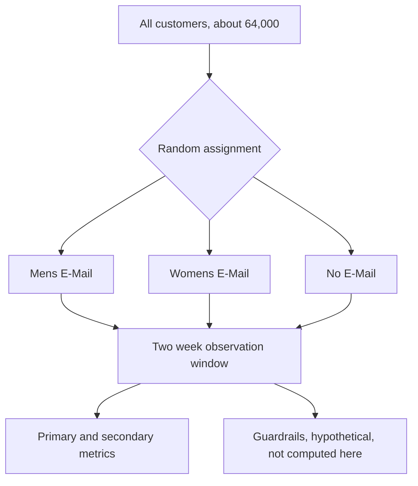

# Experiment design

This is the pre-registration record for Part 1. It was written and committed before any outcome (visit, conversion, or spend) was compared across arms. The git history is the proof that the plan below came first.

## Setup

About 64,000 customers who purchased in the last 12 months were randomly split roughly one third each into three arms. Outcomes were tracked for the two weeks after the send.

## Hypotheses

H0. The email campaign has no effect on conversion rate compared to No E-Mail, any difference seen is chance.

H1. At least one email campaign (Mens or Womens) changes conversion rate compared to No E-Mail.

The same H0 / H1 pair applies to the Mens vs Womens comparison, swapping in "between the two campaigns" for "compared to No E-Mail."

Why we chose this. Conversion is the behavior that actually matters to the business, a visit without a purchase is a weaker signal of whether the email worked.

## Metrics

**Primary metric.** Conversion rate (did the customer purchase in the two week window).

Why we chose this. It is a clean binary outcome with a straightforward power calculation, and it is the metric that actually represents whether the campaign worked. Spend is also important but is heavy tailed and noisier, so it is tracked as a secondary metric instead.

**Secondary metric.** Spend (dollars purchased in the two week window). Feeds the dollar impact estimate in the decision memo.

Why we chose this. The business decision ultimately needs a dollar figure, not just a rate, but spend is too noisy to be the primary significance test.

**Guardrail metrics (hypothetical, not computed in this dataset).** Unsubscribe rate, with a non-inferiority margin of 0.2 percentage points absolute. Visit rate on the next send 30 days later, with a drop margin of 1.5 percentage points.

Why we chose this. This dataset has no complaint, unsubscribe, or repeat-send data at all, so neither guardrail can actually be measured here. They are documented as what would be tracked in a live deployment, stated plainly as not computed, rather than left out entirely or implied as checked. Unsubscribe rate covers relationship risk, next-send visit rate covers fatigue risk, two different failure modes worth naming even without the data to test them.

## MDE, alpha, power, and sample size

MDE. 0.5 percentage points absolute lift in conversion rate.

Alpha. 0.05, two-sided.

Power. 0.90.

Sample size result, from `notebooks/00_power_and_design.ipynb`. Using the baseline conversion rate (0.9031%, validated in `notebooks/00_eda_pre_registration.ipynb`) and a planning alpha of alpha divided by 3 (the conservative bar the smallest p-value must clear under Holm correction, so the power claim stays honest after correction), the required sample size is 12,313 customers per arm. The smallest actual arm has 21,306 customers, a 1.73x margin over the requirement, which works out to 99.27% achieved power at the locked MDE, computed from the pre-specified effect size, not from any observed result.

As a separate sensitivity check, not the decision threshold, the actual sample could reliably detect effects as small as 0.3693 percentage points (about 40.9% relative lift) at this alpha and power. That number describes what the data can resolve at all, it does not replace the practical threshold below.

Why we chose this. This dataset is a retrospective analysis, the sample size was fixed before any design choice was made here, so the MDE could not be derived from a traffic or runtime decision the way it would be in a live test. 0.5 percentage points is stated as an explicit judgment call, a round threshold large enough to represent a lift worth acting on, with no cost data in this dataset available to derive a precise business breakeven value instead. Given that threshold, the required sample size is computed and checked against what we actually have, the same logical order a live experiment would follow, just run as a check instead of a forward plan. 90% power was chosen over the usual 80% default because the sample comfortably affords it at no real cost, there is no reason to accept more risk of missing a real effect when the data does not require that tradeoff. Using the corrected planning alpha instead of the raw 0.05 means the sample size claim is still true once the Holm correction is actually applied.

## Comparisons and correction

Three primary comparisons. Mens vs No E-Mail, Womens vs No E-Mail, Mens vs Womens. Corrected with the Holm method.

Why we chose this. Each comparison drives a real, costly decision (whether to roll out a campaign to the full customer base), so the family needs strict control over the chance of any false positive, not just a controlled false discovery rate. Holm gives that guarantee and is less conservative than Bonferroni.

## Pre-registered segments and correction

Segments, fixed in advance. Newbie (yes or no), channel (Phone, Web, Multichannel), zip_code (Rural, Surburban, Urban, as spelled in the source data), and recency cut into tertiles (<=3, 4-8, 9+ months, chosen because the data-driven tertiles gave far more balanced group sizes than a fixed cutoff, a 1.13x largest-to-smallest ratio versus 1.93x).

Correction. Benjamini-Hochberg (false discovery rate).

Why we chose this. Segment results feed a targeting recommendation, not an irreversible rollout, so missing a real segment effect is the costlier mistake here, not a false one. BH preserves power to catch real heterogeneity instead of over-correcting the way Holm or Bonferroni would with this many cuts.

## Analysis plan

1. Sanity checks. SRM chi-square test on the arm split, and a covariate balance table (standardized mean differences) across arms.
2. Primary readout. Confidence intervals for each pre-registered comparison on conversion rate, Holm correction applied.
3. Spend readout. Welch's t-test plus a bootstrap confidence interval (5,000 resamples, chosen from an empirical convergence check in `notebooks/00_eda_pre_registration.ipynb` showing the CI width stabilizes well before that point), noting anywhere the two methods disagree.
4. CUPED adjustment. Covariate is `history` (past 12 month spend), the pre-period variable with the strongest pooled correlation to conversion (0.0294) among the candidates checked. Variance reduction and the equivalent sample size saved are reported.
5. Segment effects. Computed only for the four pre-registered segments, BH correction applied.
6. Decision memo. Combines all of the above into a single ship or target recommendation with a dollar estimate.

## Ship or target decision rule, written in advance

Ship broadly. A campaign's lift over No E-Mail is statistically significant after Holm correction, and the estimated lift is at least the MDE (0.5 percentage points absolute).

Statistically but not practically significant. The lift is significant but below the MDE. No broad rollout recommendation from conversion alone, the dollar impact from the spend readout drives the call instead.

Targeted rollout. The overall comparison is not significant, but a pre-registered segment (BH corrected) shows a significant, practically meaningful lift. Recommend shipping to that segment only.

Do not ship. Neither the overall comparison nor any segment clears both the statistical and practical bars.

Guardrail results are reported as a stated caveat, not a gate, since neither guardrail is computed from this dataset.

Why we chose this. Statistical significance alone is not enough at this sample size, a tiny and meaningless lift could still come back significant, so the rule requires both bars before recommending a broad rollout.

## Changes from plan

### 2026-10-10, segment comparison family clarified (before any outcome was compared across arms)

The original segment section named the segments and the BH correction but did not say which comparisons run inside each segment level, so the size of the BH family was not defined. This note fixes that before any visit, conversion, or spend number is split by arm.

Segment family. Inside each of the 11 segment levels (newbie 2, channel 3, zip_code 3, recency 3), two comparisons are run, Mens E-Mail vs No E-Mail and Womens E-Mail vs No E-Mail. That is 22 tests, corrected together as one BH family. Mens vs Womens is not tested inside segments.

Why we chose this. Each of the 22 tests answers the one question the targeted rollout tier asks, whether a group responds to an email compared to getting none. Adding Mens vs Womens inside every level would make 33 tests and cost about 4 to 5 points of power per level for a question the decision rule does not ask at the segment level.

If both emails beat No E-Mail in the same segment, the choice of which email to send falls back on the overall Mens vs Womens primary comparison, which has far more sample. The gap between the two emails inside that segment is reported as context only, not as a confirmed result.

Segment power, stated in advance. Power to detect a true 0.5 percentage point lift varies a lot by level (from `notebooks/00_segment_family_power.ipynb`, using arm-pooled conversion per level, never split by arm). Under BH the real bar falls between alpha and alpha divided by 22, so power falls in a range.

| Segment level | Customers per arm (smallest) | Power at 0.5pp |
|---|---|---|
| newbie 0 / 1 | 10,611 / 10,686 | 58 to 90% / 71 to 95% |
| Phone / Web | 9,240 / 9,354 | 63 to 92% / 54 to 89% |
| Surburban / Urban | 9,501 / 8,542 | 61 to 92% / 50 to 86% |
| recency <=3 / 4-8 / 9+ | 7,438 / 7,157 / 6,529 | 30 to 71% / 48 to 85% / 46 to 84% |
| Multichannel | 2,577 | 6 to 31% |
| Rural | 3,139 | 9 to 40% |

All 11 levels stay in the analysis as originally listed. Because most levels are underpowered at the MDE, and Multichannel and Rural badly so, a segment that does not come back significant is read as inconclusive, not as evidence the email has no effect there.

### 2026-10-10, role of Mens vs Womens in the decision rule (before any outcome was compared across arms)

The original decision rule only described lift over No E-Mail, so the Mens vs Womens primary comparison had no tier of its own. It now acts as the tiebreaker.

If both Mens and Womens clear the ship broadly bars against No E-Mail, Mens vs Womens decides which one goes out. The winning email has to be significantly better after Holm correction and at least 0.5 percentage points better, the same two bars used everywhere else in the rule. If the difference is significant but below 0.5 percentage points, or not significant, the two emails are treated as tied and the spend readout decides which one ships.

Why we chose this. It gives the third Holm comparison a real decision to drive, and it reuses the statistical and practical bars that were already locked, so no new threshold is introduced.

### 2026-10-10, sanity check thresholds set (before any sanity check or outcome was run)

The analysis plan named the SRM test and the covariate balance table but not the bars they are judged against. Both are fixed here before either check is run.

SRM. A chi-square goodness of fit test of the arm counts against an equal one third split. A p-value below 0.0005 counts as a sample ratio mismatch, and the readout stops until the cause is found.

Why we chose this. SRM is a health check on randomization and logging, not a test of the treatment, so false alarms need to be rare. 0.0005 is the threshold used by Fabijan et al. (2019), "Diagnosing Sample Ratio Mismatch in Online Controlled Experiments," KDD.

Covariate balance. Standardized mean differences for recency, history, mens, womens, newbie, and each level of zip_code and channel as 0/1 indicators, for every pair of arms. Any covariate with an absolute SMD of 0.1 or more is flagged, noted in the readout, and treated as a candidate for adjustment. history_segment is left out because it is a binned copy of history. If history turns out heavily skewed, SMD on log transformed history is also reported as a robustness view, not a gate.

Why we chose this. SMD measures how big a gap is, independent of sample size, while a significance test at about 21,000 customers per arm would flag gaps too small to matter. The 0.1 cutoff follows Austin (2009), "Balance diagnostics for comparing the distribution of baseline covariates between treatment groups in propensity-score matched samples," Statistics in Medicine. It comes from observational research, so here it serves as a descriptive check that randomization produced comparable groups.

### 2026-10-10, conversion readout methods set (before any outcome was compared across arms)

The analysis plan said each primary comparison gets a confidence interval and Holm correction but did not name the interval method, its level, or the test's standard error. All three are fixed here before the readout is run.

Interval. Wald interval for the difference in conversion rates, with the unpooled standard error sqrt(p1(1-p1)/n1 + p2(1-p2)/n2). A Newcombe hybrid score interval (Newcombe 1998, Statistics in Medicine) is computed beside it as a cross-check, and any meaningful disagreement is reported.

Level. The main interval is at alpha divided by 3 (98.33%), matching the planning alpha in the power calculation, with the ordinary 95% interval shown as context. If the 98.33% interval excludes zero, the Holm adjusted p-value is guaranteed to be below 0.05, so the interval never claims more than the decision does.

Test. The z-test uses the same unpooled standard error as the interval, so the test and the interval cannot disagree. The pooled standard error is shown once as a cross-check.

Why we chose this. Wald is the simplest interval to show and defend, and a pooled pre-check found about 192 expected conversions per arm, enough for its normal approximation to hold. The Newcombe cross-check confirms that instead of assuming it.

### 2026-10-18, spend readout methods and the Womens spend rule set (before spend was compared across arms)

The analysis plan named Welch's t-test and a 5,000 resample bootstrap for spend, and the decision rule said spend drives the call when a lift is significant but below the MDE. It did not name the bootstrap interval type, the interval level, the correction, what spend result counts as a win, or what a Womens spend win means when Mens already ships broadly. All of these are fixed here before spend is split by arm. The conversion readout was already done when this note was written, so it is stated plainly where that result matters below.

Test and interval. Welch's t-test on mean spend per customer, for the same three comparisons as conversion. The main interval is a BCa bootstrap interval (Efron 1987, Journal of the American Statistical Association) with 5,000 resamples, with the percentile interval shown beside it. A convergence check on pooled spend (`notebooks/02_primary_readout.ipynb`, section 6) showed the BCa width at 5,000 resamples within about 0.7% of the width at 20,000.

Level and correction. The three spend comparisons are their own Holm family, separate from conversion. The main interval is 98.33% (alpha divided by 3), with 95% shown as context.

What counts as a spend win. A comparison counts as a significant spend lift only when both methods agree, meaning the Holm adjusted Welch p-value is below 0.05 and the 98.33% BCa interval excludes zero. If they disagree, the result is inconclusive. There is no minimum dollar bar. If Womens does not show a significant positive spend lift over No E-Mail, Womens does not ship broadly.

What a Womens spend win means. If Womens does show a significant spend lift over No E-Mail, it counts as shippable alongside Mens, and the existing tiebreaker decides which email goes out. On conversion, Mens vs Womens came back significant but below 0.5 percentage points, which the tiebreaker (locked before the conversion readout) already treats as a tie, so Mens vs Womens on spend decides. If that spend comparison is also inconclusive, Mens ships, since it is the only email that cleared both bars on the primary metric.

Why we chose this. There is no cost or margin data to base a dollar bar on, and the conversion MDE already covers whether a lift is big enough to matter. Requiring Welch and BCa to agree means no result depends on which method was picked. A pooled check at arm size (`notebooks/02_primary_readout.ipynb`, section 8) found the two can only disagree inside a band about a quarter of a standard error wide, so this costs very little power. Reusing the tiebreaker avoids adding a new threshold, and falling back to Mens keeps the final call tied to the primary metric.

### 2026-10-18, spend interval levels matched to Holm (set while applying the spend rule)

When the spend rule was applied, the two halves of "a spend win needs Welch and BCa to agree" turned out to use different bars. Holm compares its second and third smallest p-values to 0.05 divided by 2 and 0.05, but every interval was held at 98.33%. Each spend interval now uses the bar Holm uses for that comparison (98.33%, 97.5%, 95% by rank), so the p-value and the interval ask the same question. This was set after the spend readout and does not change the decision, which is Mens under either version. Both are shown in `notebooks/02_primary_readout.ipynb` (sections 9 and 10). The section 8 check above only compared Welch and BCa at a single level, so its "quarter of a standard error" figure describes method differences, not this level mismatch.
